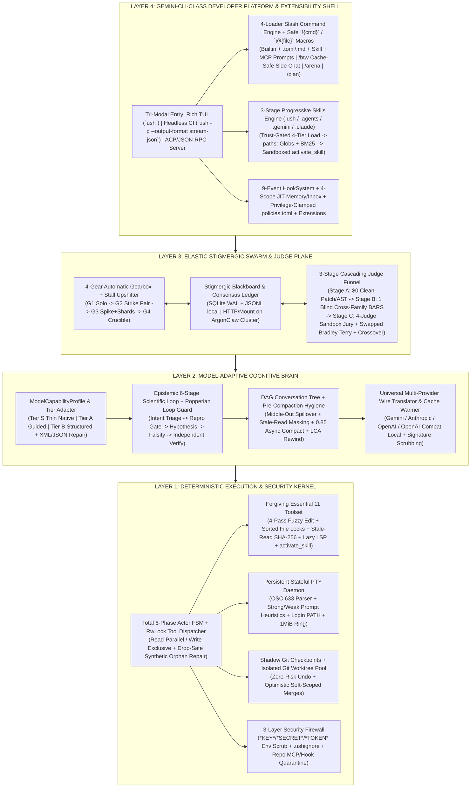

# Universal Swarm Harness (`USH`) — Master Implementation Plan

> **Mission**: Build a clean-room, **Gemini-CLI-class** coding and scientific problem-solving harness (`~5,700` core non-test LoC) engineered around three first-class invariants from Line 1:
> 1. **Universal Model Fluidity ("Runs Almost Any Model at Peak IQ")**: Maximizes solve rates across **Tier-S Frontier reasoners** (`Gemini 4 Argon`, `Claude Opus/Fable`, `GPT-5.2`), **Tier-A fast/open frontier coders** (`Gemini Flash`, `Qwen3-Coder`, `DeepSeek-V3/R1`, `GLM-5`, `Kimi-K2`, `MiniMax`), and **Tier-B local/small open-weight models** (`Ollama` / `vLLM` / `SGLang` `7B–70B`) via adaptive cognitive scaffolding, forgiving tool mechanics, BM25-budgeted skill catalogs, and lossless cross-provider wire normalization.
> 2. **Native Elastic Swarm Power ("Solo Speed by Default, Evolutionary Swarm on Demand")**: Every harness instance is simultaneously a zero-overhead solo coder (`Gear 1`) and a peer in an **Elastic Stigmergic Swarm (`Gears 2–4`)** supporting prototype-driven architecture spikes, optimistic Git-worktree islands, stigmergic `CONTRACT_DELTA` blackboards, `/arena` showdowns, heterogeneous cross-family judging, and AlphaEvolve-style genetic crossover—running identically on a **single laptop** or across **12–100+ hardened Linux containers**.
> 3. **Full Gemini-CLI-Class Developer Platform & Drop-In Extensibility**: Tri-modal UX (**Interactive Rich TUI** + **Headless `-p --output-format stream-json`** + **ACP/JSON-RPC IDE & Swarm Server**), 4-loader Slash Commands (`/btw`, `/arena`, `/plan`, `/swarm`, `/restore`, `/learn`) with injection-safe `!{}`/`@{}` macros, progressive `SKILL.md` discovery (`5` to `500+` skills compatible out-of-the-box with `.gemini/skills`, `.claude/skills`, and `.agents/skills`), 9-event lifecycle Hooks, 4-scope JIT `GEMINI.md`/`AGENTS.md` memory + `.inbox/*.patch` extraction, privilege-clamped `policies.toml`, and 1-command `ush-extension.json`/`gemini-extension.json` bundles.
>
> **Research Grounding**: Synthesizes **14 empirical teardown specifications** (`Harness_Distillation_Lab`) across 24 global coding-agent codebases.

---

## 1. Four-Layer Architecture at a Glance



---

## 2. Proposed Target Repository Structure & LoC Budget

Keeping core non-test source code around **`~5,700` LoC** delivers full Gemini-CLI-grade UX and ecosystem extensibility while staying `60x–350x` leaner than the `365k–2.01M` LoC monoliths documented in `03_KEEP_VS_CUT_BLOAT_AUDIT.md`:

```text
Universal_Swarm_Harness/
├── README.md
├── MASTER_IMPLEMENTATION_PLAN.md
├── docs/
│   ├── 01_SYSTEM_ARCHITECTURE.md                         # Kernel FSM, Essential 11 Tools, PTY, DAG & Security
│   ├── 02_UNIVERSAL_MODEL_ADAPTER_SPEC.md                # Multi-Provider Wire + Tier S/A/B Model Adaptation
│   ├── 03_ELASTIC_SWARM_AND_JUDGE_SPEC.md                # 4-Gear Swarm, Blackboard, Worktrees & Judge Funnel
│   ├── 04_VERIFICATION_AND_BENCHMARK_PLAN.md             # Conformance gates CT-01..20 & 6-KPI benchmarks
│   └── 05_CLI_SKILLS_COMMANDS_HOOKS_AND_EXTENSIONS_SPEC.md # Skills, Slash Commands, Hooks, Memory, Policies & CLI
├── schemas/                                              # (M0) JSON-RPC 2.0, Blackboard, Skill, Policy & Ext schemas
├── kernel/                                               # Layer 1: Execution, PTY, Patch, Shadow Git & Security (~1,850 LoC)
│   ├── fsm/                                              # 6-phase state machine, epoch leases, TurnSteerQueue, RwLock gate
│   ├── tools/                                            # Essential 11 tools, 4-pass fuzzy patcher, sorted file locks
│   ├── pty/                                              # Persistent PTY manager, OSC 633 parser, prompt heuristics, 1MiB cap
│   ├── vcs/                                              # Out-of-tree Shadow Git snapshots + Git worktree pool & merge-tree
│   ├── code_intel/                                       # Tree-sitter repo map + lazy on-demand read-side LSP client
│   └── security/                                         # Child-env secret scrubber, .ushignore firewall, repo trust store
├── brain/                                                # Layer 2: Universal Wire, Tier Adapter, DAG Memory & Loop (~1,350 LoC)
│   ├── providers/                                        # Gemini, Anthropic, OpenAI Responses/Chat, Ollama/vLLM/OpenRouter
│   ├── wire_transform/                                   # Cross-model signature/ID/image normalizer + KV cache warmer
│   ├── model_tiers/                                      # Capability registry, Tier S/A/B prompt/tool adapters, XML/JSON repair
│   ├── epistemic/                                        # 6-stage scientific loop, Popperian streak detector, repro gate
│   └── context_dag/                                      # Session tree, LCA branch summarizer, stale-read masking, 0.85 compactor
├── swarm/                                                # Layer 3: Elastic Stigmergic Swarm & Calibrated Judge (~1,250 LoC)
│   ├── gearbox/                                          # Complexity estimator + Gear 1..4 router + live stall upshifter
│   ├── blackboard/                                       # Append-only event bus (SQLite WAL local + HTTP/Mount cluster driver)
│   ├── roles/                                            # Spike Explorer, Optimistic Builder, Integrator, Crossover, /arena
│   └── judge/                                            # Clean-patch runner, blind BARS critic, Sandbox Prosecutor, Bradley-Terry
├── platform/                                             # Layer 4a: Extensibility Engine (~800 LoC)
│   ├── skills/                                           # 4-tier trust loader, colon-safe YAML, paths: glob, BM25 delta, activate_skill
│   ├── commands/                                         # Builtin/TOML-MD/Skill/MCP loaders, SlashCommandResolver, !{}/@{} processors, /btw
│   ├── hooks_policies/                                   # 9-event HookSystem + 4-tier privilege-clamped TOML PolicyEngine
│   └── memory_extensions/                                # 4-scope + JIT AGENTS/GEMINI.md, .inbox/*.patch extractor, extension installer
├── cli/                                                  # Layer 4b: Tri-Modal UX (~450 LoC)
│   ├── tui/                                              # Streaming diff TUI, / @ $ popups, !shell mode, approval cards, status bar
│   ├── headless/                                         # `ush -p` Unix stdin/stdout + `text | json | stream-json` emitter
│   └── acp_server/                                       # `ush serve --acp | --jsonrpc` IDE & Swarm Peer daemon
└── tests/                                                # Conformance (CT-01..20), mock-model chaos, & 6-KPI trajectory suite
```

---

## 3. Language & Runtime Strategy (Three Clean Options)

Based on our empirical teardown (`08_RUST_VS_PYTHON_HARNESS_ARCHITECTURE_COMPARISON.md`), `USH` enforces a strict **NDJSON JSON-RPC 2.0 internal seam** between `kernel/` (Layer 1) and `brain/` + `swarm/` (Layers 2–3), enabling three build paths:

| Option | Layer 1 (`kernel/`) | Layers 2–3 (`brain/` + `swarm/`) | Tradeoff Summary |
| :--- | :--- | :--- | :--- |
| **Option A *(Recommended)***: **Rust Execution Kernel + Python Cognitive/Swarm Brain** | **Rust** (`tokio`, `<25 MB` RSS/worker, drop-safe `RwLock`/PTY/sandbox, native static `ush-kerneld` binary) | **Python 3.12+** (`pydantic`, rapid prompt/judge/swarm iteration, AST tool-forge, native science/eval stack) | **Best of both worlds**: Codex-grade process/PTY/memory safety at 50-worker swarm scale + Python's `10x` iteration speed on swarm & judge algorithms. |
| **Option B**: **Pure Python v0.1 First $\to$ Rust `kernel/` Drop-In in v0.2** | **Python 3.12+** initially (behind the exact JSON-RPC boundary), swapped to Rust once swarm workflows stabilize | **Python 3.12+** | **Fastest path to end-to-end runnable swarm** (days instead of weeks); zero rewrite of `brain/` or `swarm/` when `kernel/` upgrades to Rust. |
| **Option C**: **100% Rust (or Go) Single Static Binary** | **Rust** (or **Go**) | **Rust** (or **Go**) | Zero Python runtime dependency on target machines (`scp` one binary anywhere), at the cost of slower experimentation on fuzzy judges & PTC scripts. |

---

## 4. Eight-Milestone Phased Delivery Roadmap (`M0` $\to$ `M7`)

Every milestone produces a **working, end-to-end testable artifact** gated by automated deterministic checks—never big-bang integration at the end.


### Milestone 0 (`M0`) — Protocol Schemas & Universal Multi-Model Wire Layer
- **Goal**: Speak fluently to **every major cloud and local model provider** and hot-swap models mid-conversation without a single `400` wire error or broken KV-cache prefix.
- **Deliverables**:
  1. Normative schemas (`Turn`, `Step`, `CanonicalMessage`, `ModelCapabilityProfile`, `BlackboardEvent`).
  2. Native streaming adapters (`SSE` `DeltaSplitter`) for **Google Gemini / Vertex**, **Anthropic Messages**, **OpenAI Responses & Chat**, and **OpenAI-Compatible Local/OSS** (`Ollama`, `vLLM`, `SGLang`, `OpenRouter`, `Qwen`, `DeepSeek`, `Kimi`, `GLM`).
  3. **6-Rule `transformMessages` Normalizer** ([02_UNIVERSAL_MODEL_ADAPTER_SPEC.md](docs/02_UNIVERSAL_MODEL_ADAPTER_SPEC.md)): foreign `thoughtSignature`/`thinking` stripping on model switch, 64-char tool-ID remapping, error-image splitting, `EMPTY_200_RESPONSE` retry, `MAX_TOKENS` 0-tool auto-continue, and `<dynamic_instructions>` tail-only erasure for `>90%` KV-cache hits + econometric TTL cache warmer.
  4. **Forgiving Tool-Call Repair**: Native tool-call parser + automatic fallback parser/1-turn repair loop for Tier-B local models that emit fenced JSON/XML or trailing commas.
- **Exit Gate**: Replay a single 12-turn multimodal + tool-calling session rotating live across `Gemini` $\to$ `Claude` $\to$ `OpenAI` $\to$ `Local/OpenAI-Compat` with `0` wire errors.

### Milestone 1 (`M1`) — Forgiving Execution Kernel: Fuzzy Patch, Persistent PTY & Shadow Git
- **Goal**: Eliminate the mechanical tool friction that wastes 25–40% of agent turns—especially on mid/small models.
- **Deliverables**:
  1. **Total 6-Phase Actor Loop (`FSM`)** + `RwLock` Tool Gate (parallel reads, exclusive writes, lexicographically sorted per-file mutexes, and drop-safe synthetic `tool_result` repair on cancel/timeout).
  2. **4-Pass Fuzzy `edit_file` Engine** (exact $\to$ `trim_end` $\to$ `trim` $\to$ Unicode dash/quote/space folding + CRLF-preserving LCS line endings) + **SHA-256 Stale-Read Guard** (returns unified diff on external file mutation instead of clobbering).
  3. **Persistent Stateful PTY Manager**: `OSC 633` boundary-safe marker parser + `strong`/`weak` markerless prompt-strength heuristics (never hangs on `ssh`, `[y/N]`, or `git`), login-shell `PATH` probe, `1 MiB` middle-out `HeadTailBuffer` + disk spillover (`<scratch>/tool_outputs/<id>.log`), and `IsDaemon` background process tracking.
  4. **Out-of-Tree Shadow Git Snapshot Store**: Pre-step `capture()`, `diff()`, and surgical `restore()` with zero pollution of the user's real `.git/index`.
- **Exit Gate**: Edit failure rate `<2%` across CRLF/Unicode/whitespace torture fixtures; `0` hung turns across interactive `[y/N]`, `less` pager, `2 GB` stdout flood, and mid-tool `SIGINT` cancellation tests.

### Milestone 2 (`M2`) — Epistemic Reasoning Loop, Model-Tier Scaffolding & DAG Context
- **Goal**: Sustain coherent, self-correcting multi-hour problem solving across `32k` local windows and `1M+` frontier windows alike.
- **Deliverables**:
  1. **3-Tier Adaptive Cognitive Scaffolding (`Tier S / A / B`)**: Auto-adjusts system prompt density, parallel tool batch caps (`8` vs. `4` vs. `1`), explicit `<hypothesis>` reflection nudges for non-thinking models, and dynamic tool-schema slimming.
  2. **Epistemic 6-Stage Loop & Popperian Loop Guard**: Mandatory bug-reproduction-before-edit gate + SHA-256 command/edit cycle detector escalating at `Streak 3 / 5 / 8` to force hypothesis falsification.
  3. **Pre-Compaction Hygiene + `0.85` Speculative Async Compactor**: Reverse-scan superseded file-read tombstoning + structured epistemic compaction summaries preserving exact file paths, failing assertions, and falsified dead ends.
  4. **DAG Conversation Tree & `LCA` Branch Summarizer**: Rewind from any dead-end leaf to an earlier checkpoint while injecting a compact summary of negative findings and touched files from the abandoned branch.
  5. **Long-Form `/goal` Supervisor**: Tri-dimensional `[token, turn, wallTime]` budgets + `5`-condition server quiescence barrier.
- **Exit Gate**: Multi-compaction 80-step autonomous run completes with `0` context-overflow errors, `0` repeated falsified edits, and intact goal fidelity after `3` compaction cycles + `1` branch rewind.

### Milestone 3 (`M3`) — Structural Code Intelligence, 3-Layer Security & Live Human Steering
- **Goal**: Navigate large unfamiliar repositories in 2–3 turns safely while partnering seamlessly with a human operator.
- **Deliverables**:
  1. **Zero-Turn Tree-Sitter RepoMap + Lazy Read-Side LSP**: Ranked symbol/signature skeleton for fast orientation + on-demand `lsp_query(definition | references | hover | incoming_calls | outgoing_calls)` with bounded 1,000-char error reporting (zero eager edit-time lag).
  2. **3-Layer Context & Execution Security Firewall**: Child-env `*KEY*`/`*SECRET*`/`*TOKEN*` scrubbing, live-watched `.ushignore`/`.clineignore` file firewall, host-signed repo `.mcp.json`/hook trust quarantine, and `<untrusted_data>` prompt-injection framing + high-risk action gate.
  3. **Protocol-Safe `TurnSteerQueue` & Crash-Resumable `ask_user`**: Inject user text/screenshots mid-turn drained strictly between `tool_result` closure and next LLM call; reload sessions paused on `ask_user` cleanly.
- **Exit Gate**: Pass 100% of secret-leakage, malicious-repo `.mcp.json` quarantine, and mid-tool-batch live-steering conformance tests.

### Milestone 4 (`M4`) — Gemini-CLI-Class Developer Platform: Tri-Modal UX, Skills, Slash Commands, Hooks, Memory, Policies & Extensions
- **Goal**: Deliver a first-class interactive + headless + ACP developer CLI compatible out-of-the-box with `.gemini/skills`, `.claude/skills`, `.agents/skills`, `GEMINI.md`, `AGENTS.md`, and `gemini-extension.json` ([05_CLI_SKILLS_COMMANDS_HOOKS_AND_EXTENSIONS_SPEC.md](docs/05_CLI_SKILLS_COMMANDS_HOOKS_AND_EXTENSIONS_SPEC.md)).
- **Deliverables**:
  1. **Tri-Modal CLI Shell**: Rich streaming TUI (`ush` with `/command`, `@file`, `$skill` popups, `!cmd` shell toggle, `Ctrl+V` image paste, live diff/approval cards, and `model | tier | ctx% | cache% | gear` status bar) + Headless Unix mode (`ush -p --output-format text|json|stream-json`) + ACP/JSON-RPC daemon (`ush serve --acp`).
  2. **3-Stage Universal Skills Engine**: 4-tier trust-gated discovery (`Builtin < Ext < User < Trusted Workspace`), colon-safe YAML frontmatter parser, Qwen-style `paths:` glob hiding, Codex-style BM25/LRU token-budgeted `<skills_delta>` tail injector (`0` Turn-0 KV-cache churn even at `500+` skills & `Tier B` 14B models), and enum-typed `activate_skill` dynamically unlocking `dirname(skill.path)` read-sandbox access + `context: inline | fork`.
  3. **4-Loader Slash Command Engine & Safe Macro Pipeline**: `BuiltinCommandLoader` (unshadowable) + `FileCommandLoader` (`.toml` & `.md` with shell-escaped + `PolicyEngine`-gated `!{cmd {{args}}}` and ignore-safe multimodal `@{file}`) + `SkillCommandLoader` + `McpPromptLoader`, including **`/btw`** (100%-KV-cached `NO_TOOLS` zero-history side Q&A while agent runs), `/plan`, `/restore`, `/tree`, `/learn`, and `/doctor`.
  4. **9-Event `HookSystem`, 4-Scope + JIT Memory/Inbox, `policies.toml` & Extensions**: `BeforeToolSelection`/`BeforeModel`/`BeforeTool`/`AfterTool`/`PreCompress`/`Stop` hooks; inode-deduplicated global $\to$ JIT-package `AGENTS.md`/`GEMINI.md` loader + untrusted-transcript-safe `.inbox/*.patch` skill/memory extractor; 4-tier `policies.toml` engine (`allow`/`yolo` hard-clamped on extensions) + `ush extensions install`.
- **Exit Gate**: Pass 100% of `CT-14..CT-17` (500-skill KV-cache stability, out-of-repo skill resource read grant, `!{}` shell-injection blocking, `/btw` zero-mutation concurrency, and extension privilege clamping).

### Milestone 5 (`M5`) — Calibrated Judge Engine (`Clean-Patch` + `BARS` + `Sandbox Prosecutor` + `Bradley-Terry`)
- **Goal**: Grade both deterministic software tasks and fuzzy/open-ended design tasks with zero self-certification bias ([03_ELASTIC_SWARM_AND_JUDGE_SPEC.md](docs/03_ELASTIC_SWARM_AND_JUDGE_SPEC.md)).
- **Deliverables**:
  1. **Stage A Deterministic Sieve (`$0`)**: Test-file tampering stripper (`clean_patch`), regression runner, AST security verifier, and dynamic **Executable Proxy Synthesizer** (e.g., headless CDP layout/console assertions for UI, benchmark scripts for perf).
  2. **Stage B Provenance-Blind Cross-Family Sentinel**: Strips author `<thinking>` and identity (`ContextMode::DropAll`), routes specifically to a *different* model family than the builder, grades Atomic `BARS` (`0 / 0.5 / 1`) + multiplicative Hard Vetoes $\prod h_m$, and fast-passes when `BARS >= 0.90` & `uncertainty <= 0.15`.
  3. **Stage C Specialist Jury & Swapped Pairwise Bradley-Terry Tournament**: Parallel blind votes (`Sandbox Red-Team Prosecutor`, `Occam/Architecture Critic`, `Security & Verbatim-Intent Auditor`) $\to$ bounded split-only rebuttal $\to$ position-swapped $(A, B)$ & $(B, A)$ Bradley-Terry MLE ranking + Dawid-Skene reliability weighting.
- **Exit Gate**: Catch `>=95%` of seeded test-weakening cheats, hallucinated `"Tests pass!"` claims, and position-biased judge flips across verification fixtures (`CT-18`).

### Milestone 6 (`M6`) — The 4-Gear Elastic Stigmergic Swarm & `/arena` (Local Laptop + Distributed Cluster)
- **Goal**: Unleash coordinated multi-agent intelligence that scales effort dynamically to problem difficulty without rigid waterfall stalls.
- **Deliverables**:
  1. **4-Gear Automatic Gearbox + Runtime Stall Upshifter + `/arena`**: Starts in `Gear 1 (Solo)` or `Gear 2 (Builder + Cross-Family Critic)`; automatically upshifts to `Gear 3 (Executable Spikes + Parallel Worktrees)` when `thrash_streak >= 2` or `Gear 4 (Full Blind 3-Lens Architects + Sealed Holdout Rubric + MAP-Elites Islands + Crossover)` on hard/fuzzy problems, plus interactive `/arena --models m1,m2` worktree races.
  2. **Optimistic Git Worktree Pool & 3-Tier Semantic Merger**: Full repo edit freedom per worker + advisory `primary_scope` hints; auto-reconciles via `git merge-tree` $\to$ Integrator agent $\to$ Judge tie-break.
  3. **Stigmergic Blackboard & Heterogeneous Fleet Scheduler**: Append-only `blackboard.jsonl` + SQLite WAL lease ledger (with pluggable remote container workspace + SHA-256 `ConsensusLedger` adapter); broadcasts 3-line `CONTRACT_DELTA` cards across sibling worktrees and rotates hats (`Explorer` $\to$ `Builder` $\to$ `Cross-Judge`) enforcing `judge_id not in contributor_ids`.
  4. **Behavioral Deduplication & Round-2 Genetic Crossover**: Groups behaviorally equivalent candidate patches and spawns a Crossover Builder to fuse complementary rubric winners.
- **Exit Gate**: Pass `CT-19..CT-20` and demonstrate (a) zero-overhead Gear 1/2 execution on routine fixes, (b) live mid-flight stall upshift from Gear 2 $\to$ Gear 3 worktree islands, and (c) multi-model swarm solve (`Gemini` + `Claude` + `Local/Fast` scouts) outperforming every constituent single model on multi-module + hard-bug tasks.

### Milestone 7 (`M7`) — 6-KPI Trajectory Benchmark, Multimodal QA & Offline "Dream" Memory
- **Goal**: Make harness quality monotonically measurable and self-improving over time ([04_VERIFICATION_AND_BENCHMARK_PLAN.md](docs/04_VERIFICATION_AND_BENCHMARK_PLAN.md)).
- **Deliverables**:
  1. **Automated 6-KPI Rollout Benchmark Harness**: Measures Solve Rate, Edit Failure Rate (`<2.5%`), KV-Cache Hit Rate (`>90%`), Thrash/Re-Read Rate, False-Victory Catch Rate, and Swarm Cost-Efficiency across model tiers.
  2. **Multimodal CDP / PTY (`tuistory`-style) Sensory Adapter**: Visual browser & terminal verification hooks integrated directly into Builder and Stage-A/C Judge tools.
  3. **PID-Locked Offline "Dream" Consolidator**: Periodic reflection over completed JSONL session logs staging durable `.inbox/*.patch` memory and skill updates without polluting live boot prompts.
- **Exit Gate**: Full CI green on Conformance Suite `CT-01..CT-20` + baseline 6-KPI scorecard generated across at least 2 distinct model families.

---

## 5. Key Design Decisions to Align On Before Writing `M0` Code

1. **Implementation Language Split**:
   - **Recommended (`Option A` / `B`)**: Lock the NDJSON JSON-RPC seam now; either build `kernel/` + `cli/tui` in **Rust** (`tokio` + `ratatui`, `<25 MB` binary) + `brain/`/`swarm/`/`platform/` in **Python 3.12+**, *or* build `M0–M6` in **clean modular Python 3.12+ first** (`Textual`/`prompt_toolkit` TUI) for fastest end-to-end bring-up and drop in the Rust `kernel/` crate once interfaces solidify. *(Or **Option C**: 100% Rust or TypeScript/Bun Gemini-CLI-style single runtime.)*
2. **First-Wave Model Providers for Live Testing**:
   - Which model endpoints should `M0` wire up and test against on Day 1 (e.g., **Gemini (`4 Argon` + `3.8 Flash`) + Anthropic (`Claude Opus/Fable`) + local `Ollama`/`vLLM`/OpenAI-compat**)?
3. **Swarm Deployment Target Priority**:
   - Build **local multi-worktree laptop swarm** first (SQLite WAL + local Git worktrees) with a clean adapter into remote container clusters (`SWARM_HOST`), or wire directly into distributed containers in `M6`?
